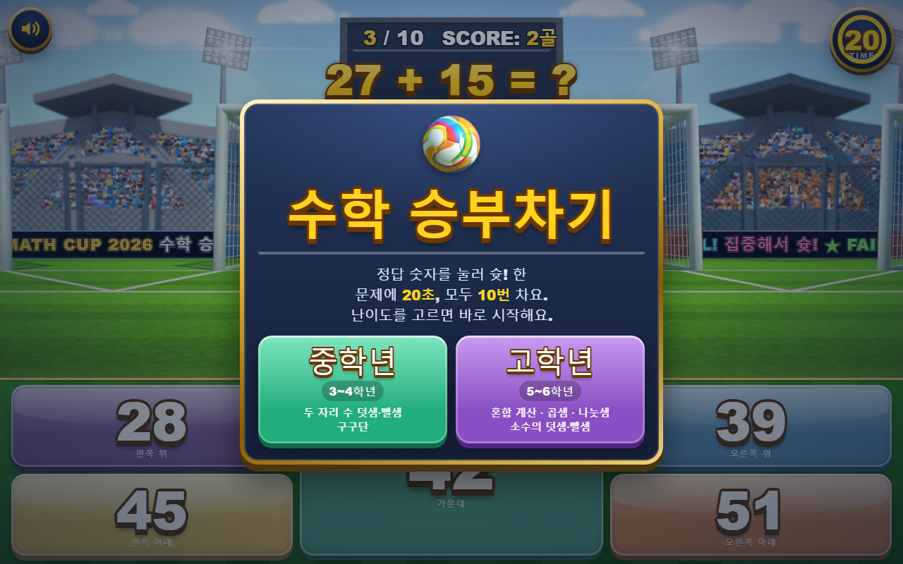
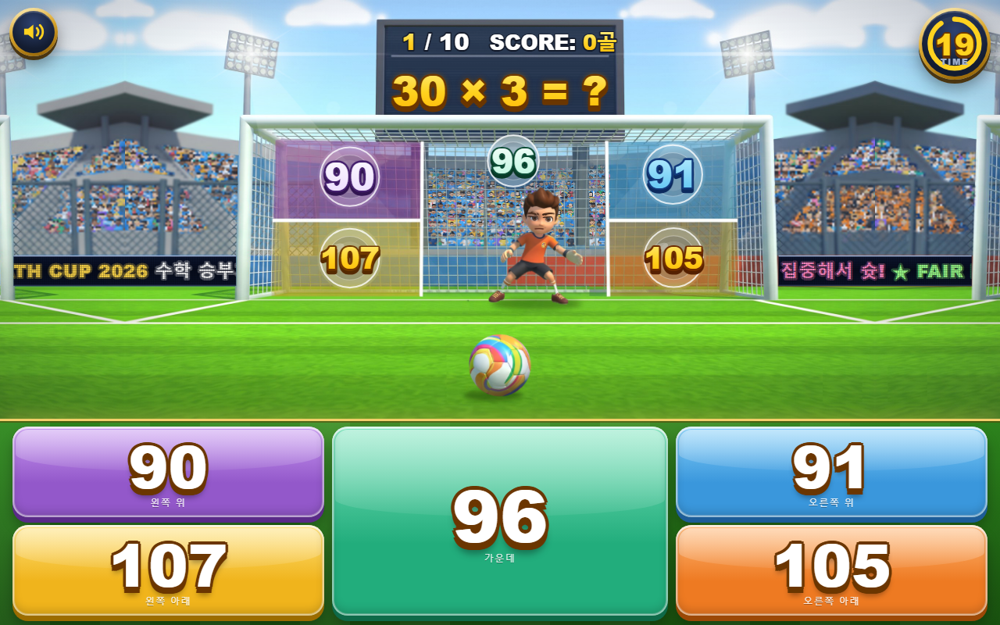
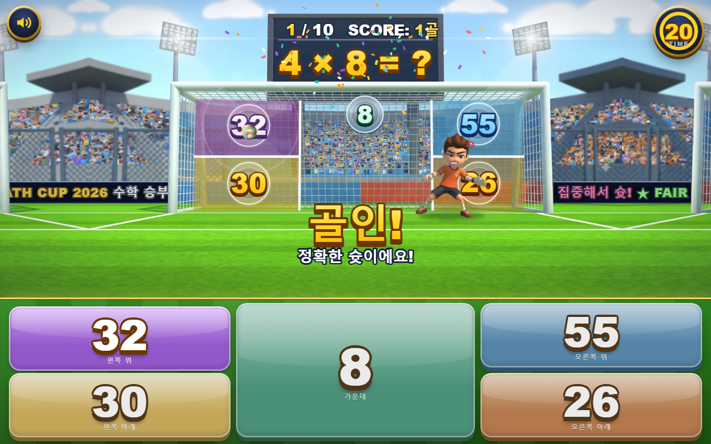
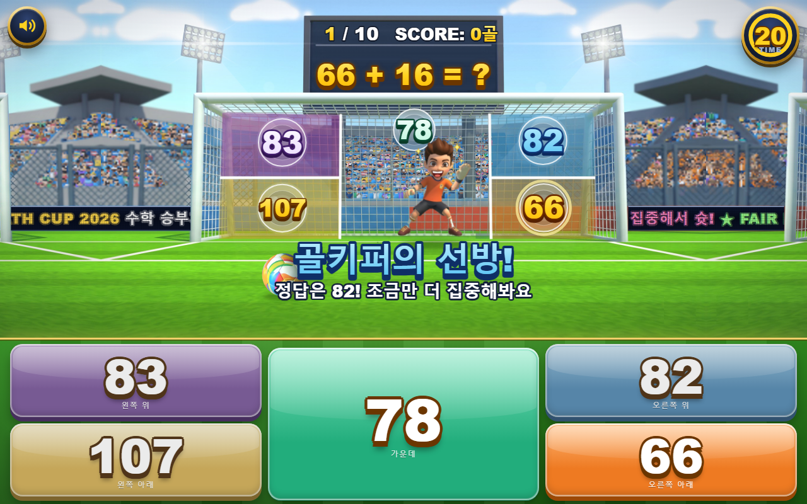

# ⚽ 수학 승부차기

초등학생이 사칙연산 문제의 정답을 골라 페널티킥을 차는 교실용 수학 게임입니다.
정답을 고르면 골이 들어가고, 오답을 고르면 골키퍼가 막습니다. 한 판은 10문제이고, 한 문제에 20초가 주어집니다.

- **바로 플레이:** https://leekkyuho.github.io/math-penalty-kick/
- **설치 없음:** `index.html` 파일 하나로 실행되며 인터넷 연결이 필요 없습니다.
- **개인정보 없음:** 이름이나 기록을 저장하지 않습니다. 소리 켬/끔 설정만 브라우저에 남습니다.

| 시작 화면 | 문제 풀이 |
|---|---|
|  |  |
| **골인** | **골키퍼 선방** |
|  |  |

<p align="center"></p>

## 1. 실행 방법

| 방법 | 이렇게 하세요 | 이럴 때 좋아요 |
|---|---|---|
| 웹에서 바로 | 위 **바로 플레이** 주소를 엽니다 | 학생들에게 주소나 QR 코드를 나눠 줄 때 |
| 파일로 실행 | `index.html`을 내려받아 더블클릭합니다 | 교실 인터넷이 불안정할 때, USB로 옮길 때 |

- Chrome, Edge, Whale, Safari 최신 버전에서 동작합니다.
- 전자칠판, 노트북, 태블릿, 휴대폰 화면에 맞춰 자동으로 배치됩니다. 가로 화면을 권장합니다.
- 전자칠판에서는 `F11`을 눌러 전체 화면으로 쓰면 가장 좋습니다.
- 파일 하나만 내려받으려면 이 페이지 위쪽의 `index.html`을 누른 뒤 오른쪽 위 **Download raw file(⬇)** 버튼을 누르세요.

## 2. 게임 방법

1. 시작 화면에서 **중학년** 또는 **고학년**을 고르면 바로 시작합니다.
2. 전광판에 문제가 나오고, 골대의 다섯 곳(왼쪽 위·아래, 가운데, 오른쪽 위·아래)에 숫자가 붙습니다.
3. 아래 버튼 중 정답 숫자를 누르면 그 방향으로 슛을 찹니다.
4. 10번을 모두 차면 결과가 나옵니다. **10골 만점**이면 트로피 수여식이 열립니다.

| 상황 | 화면에서 일어나는 일 |
|---|---|
| 정답 | 골인! 골망이 흔들리고 꽃가루가 날립니다. 관중이 환호하고 골키퍼는 분해합니다. |
| 오답 | 골키퍼가 몸을 날려 펀칭으로 막고, 정답을 알려 줍니다. 관중이 아쉬워합니다. |
| 20초 초과 | 휘슬이 울리고 정답이 표시된 뒤 다음 문제로 넘어갑니다. |
| 10골 만점 | 웅장한 음악과 함께 트로피 수여식이 열립니다. |

정답 위치는 매번 무작위로 바뀌며, 같은 곳이 세 번 연속 나오지 않습니다.
오답 보기 중 두 개는 정답과 가까운 수라서 어림만으로는 고르기 어렵습니다.

## 3. 난이도

| 난이도 | 대상 | 문제 유형 | 예시 |
|---|---|---|---|
| 중학년 | 3~4학년 | 두 자리 수 덧셈 (받아올림 포함) | `47 + 38 = ?` |
| | | 두 자리 수 뺄셈 (받아내림 포함) | `82 − 27 = ?` |
| | | 구구단 (2~9단) | `7 × 8 = ?` |
| 고학년 | 5~6학년 | 곱셈·덧셈 / 곱셈·뺄셈 혼합 계산 | `6 × 7 + 18 = ?`, `90 − 8 × 6 = ?` |
| | | (두 자리 수) × (한 자리 수) | `36 × 7 = ?` |
| | | 나머지 없는 나눗셈 | `56 ÷ 8 = ?` |
| | | 소수 한 자리 수의 덧셈·뺄셈 | `3.7 + 4.6 = ?`, `8.2 − 2.5 = ?` |

문제 범위를 바꾸려면 `src/template.html`의 `LEVELS` 부분을 고친 뒤 다시 빌드하세요. 아래 **5. 수정하는 방법**을 참고하세요.

## 4. 화면 구성과 기능

- **전광판:** 현재 문제 번호(○ / 10)와 넣은 골 수를 보여 줍니다.
- **타이머:** 오른쪽 위 원형 타이머가 20초부터 줄어듭니다. 5초 이하가 되면 주황색으로 바뀌며 두근거립니다.
- **골키퍼:** 문제를 푸는 동안은 진지한 표정입니다. 막으면 웃고, 골을 먹으면 화난 표정으로 바뀝니다.
- **관중:** 약 900명의 관중이 사람마다 다르게 반응합니다.
  - 골이 들어가면 만세, 박수, 깃발 흔들기로 환호합니다.
  - 막히면 머리를 감싸거나 이마를 짚습니다.
  - 오른쪽 아래 주황색 응원석은 골키퍼 팀이라 반대로 반응합니다.
- **소리:** 왼쪽 위 스피커 버튼으로 켜고 끕니다. 모든 효과음과 음악은 브라우저에서 직접 합성하므로 음원 파일이 없습니다.
- **동작 줄이기:** 기기에서 '동작 줄이기(애니메이션 줄이기)'를 켜면 흔들림과 관중 움직임이 줄어듭니다.

## 5. 수정하는 방법

게임은 `src/` 폴더의 원본을 합쳐 `index.html` 한 파일로 만듭니다. 이미지는 파일 안에 base64로 들어갑니다.

```powershell
# 저장소 폴더에서 실행 (Windows PowerShell)
powershell -ExecutionPolicy Bypass -File src\build.ps1
```

| 바꾸고 싶은 것 | 고칠 곳 (`src/template.html`) |
|---|---|
| 문제 범위·유형 | `const LEVELS = { mid: …, high: … }` |
| 문제 수, 제한 시간 | `const TOTAL = 10, TIME_LIMIT = 20;` |
| 결과 화면 칭찬 문구 | `function showResult()` |
| 시작 화면 안내 문구 | `<div class="overlay" id="intro">` |

## 6. 폴더 구조

```
math-penalty-kick/
├── index.html              # 완성된 게임 (이 파일 하나로 실행, GitHub Pages 시작 페이지)
├── README.md
├── docs/
│   └── screenshots/        # README에 쓰인 화면 캡처
└── src/
    ├── template.html       # 게임 원본 (HTML·CSS·JavaScript)
    ├── build.ps1           # template.html + assets → index.html
    ├── assets/
    │   ├── bg.jpg          # 경기장 배경
    │   ├── keeper.png      # 골키퍼 (전체)
    │   ├── k_body.png      # 골키퍼 몸통 (펀칭 동작용)
    │   ├── k_armL.png      # 골키퍼 왼팔
    │   ├── k_armR.png      # 골키퍼 오른팔
    │   ├── ball.png        # 축구공
    │   └── m_L/m_R/m_C.png # 관중석 좌석 마스크 (관중이 그려질 자리)
    └── tools/              # 원본 그림에서 위 이미지를 잘라 낸 도구 (C#, PowerShell)
        ├── run.ps1         # 배경·골키퍼·공 생성
        ├── Proc.cs         # 배경 정리 (글자·숫자 지우기, 원근 흐림, 구름)
        ├── Rig.cs          # 골키퍼 몸통·팔 분리
        └── Crowd.cs        # 관중석 좌석 마스크 생성
```

`src/tools`는 원본 그림(`orig.png`)이 있어야 실행됩니다. 원본 그림은 저장소에 포함하지 않았고, 가공이 끝난 이미지만 `src/assets`에 들어 있습니다.
게임을 고치거나 실행하는 데에는 `src/tools`가 필요 없습니다.

## 7. 문제 해결

| 증상 | 해결 방법 |
|---|---|
| 소리가 나지 않아요 | 왼쪽 위 스피커 버튼이 켜져 있는지, 기기 음량이 켜져 있는지 확인하세요. 브라우저 정책 때문에 화면을 한 번 누른 뒤부터 소리가 납니다. |
| 화면이 잘려 보여요 | 브라우저 창을 가로로 넓히거나 `F11` 전체 화면을 쓰세요. 휴대폰은 가로로 돌리면 더 크게 보입니다. |
| 오래된 태블릿에서 끊겨요 | 기기 설정에서 '동작 줄이기'를 켜면 관중 움직임이 줄어 가벼워집니다. |
| 내려받은 파일이 글자로만 보여요 | `index.html`을 메모장이 아닌 브라우저(Chrome, Edge)로 여세요. |

## 8. 만든 사람과 출처

- 기획: [@leekkyuho](https://github.com/leekkyuho)
- 개발: Claude Code(Anthropic)와 함께 제작
- 이미지: 제작 교사가 준비한 경기장·골키퍼 그림을 게임용으로 가공해 사용했습니다.
- 효과음·음악: Web Audio API로 직접 합성했습니다. 외부 음원은 쓰지 않았습니다.
- 외부 라이브러리: 사용하지 않습니다.
